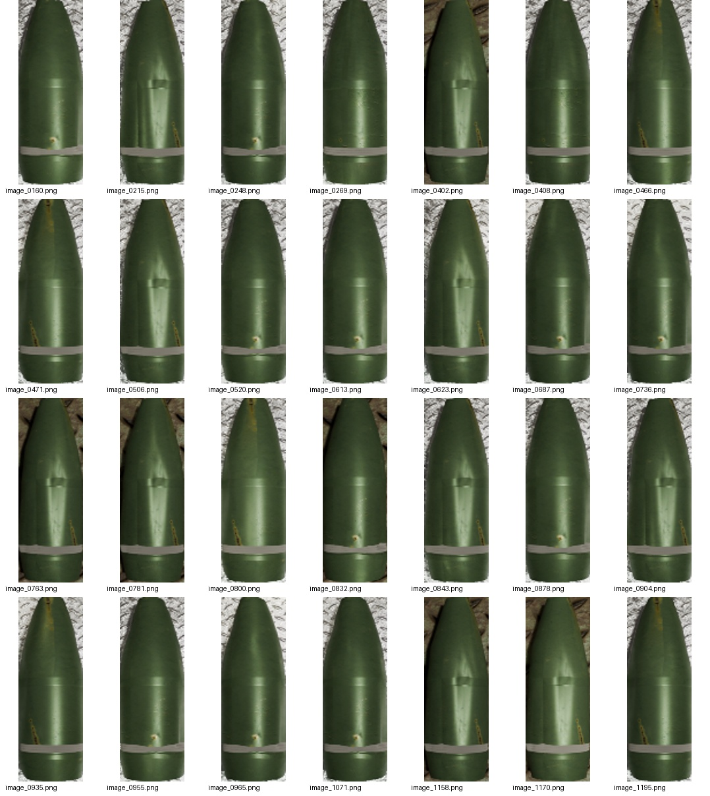

# Bad BOMB

## Task

Find 28 unusual shells in an unlabelled image collection and submit their filenames in `test-output.txt`. At least 20 must match the hidden defect labels to reach the 70% passing threshold.

## Approach

We separate the green shell from its background, estimate its main axis and align it to a common crop. This reduces differences caused by rotation, position and the two background styles. Brightness is normalised before fitting a three-component principal component analysis model to the image collection.

The model learns the largest shared appearance variations without using labels. We reconstruct each shell and score its strongest local differences from that reconstruction. Looking at a small high-error region helps keep a local defect from being averaged away over the whole image.

We also look for small red or brown regions inside the green body. These expose cracks and notches that a reconstruction model can overlook. The colour rule finds 16 candidates. We fill the remaining 12 places using reconstruction scores, producing exactly 28 unique filenames. No image IDs are hardcoded in the selection code.

The first submission matched 19 of 28 labels on the platform, just below the 20 matches needed. We then checked it with a separate pretrained MobileNet feature extractor. It compares corresponding image patches across the collection, using the nearest 15 other examples at each position. An image score is the average of its five most unusual patches.

The revised submission replaces the two lowest-ranked initial choices with the two highest-ranked unselected candidates under that second model. This removes `image_0428.png` and `image_0714.png`, and adds `image_0269.png` and `image_0408.png`. The other 26 entries remain unchanged. The choices are computed from scores, not hardcoded in `refine.py`.

## Why it works

Most shells share the same shape and surface appearance. Lighting and background changes are common, while local distortions, holes and long cracks are rare. Alignment and brightness normalisation remove some common variation, leaving those differences easier to rank. The colour check complements the reconstruction score rather than depending on the model to find every defect type.

## Run it

Extract the supplied archive so that `images/` and `train-output.txt` sit beside `main.py`. The images are kept locally and ignored by Git because the supplied collection is about 641 MB uncompressed.

Install the dependencies and regenerate the submission:

```bash
python -m pip install -r requirements.txt
OPENBLAS_NUM_THREADS=2 python main.py
python -m pip install -r requirements-refine.txt
python refine.py --checkpoint ../../../South-America/Ecuador/Ciclopaseo-Mirage/classifier/mobilenet_v3_large-5c1a4163.pth
python validate_submission.py
```

The refinement uses the ImageNet MobileNetV3 checkpoint already supplied with the Ecuador task. It does not use that task's labels or adversarial images. Pass the path to the same checkpoint if running this task outside the repository. No model is downloaded by either script.

The environment variable limits numerical-library threads on Linux. On Windows, run `python main.py` directly. Only `test-output.txt` needs to be uploaded to the platform.

## Evidence and limits

The actual archive contains 1,241 images, although the task description says 1,125. Sixteen are byte-identical extra copies with `(1)` in their names. We analysed every supplied image and preserved its original filename. None of those extra copies was selected.

`results/scores.csv` records both scores and the selection for every image. `results/pca-model.npz` contains the learned components, mean and interior mask. `results/summary.json` records the counts. The output validator confirms 28 unique paths, all pointing to existing images in the required format.

The initial visual review suggested body distortions, notches and long cracks, but the platform showed that appearance alone did not identify all of the labelled defects. The current list includes two additional small surface marks found by the patch-feature model. The revised submission passed the platform, as confirmed by our team.

`results/submission-1.txt` preserves the first list and its 19/28 feedback is in `results/platform-feedback.json`. `results/submission-2.txt` is the revised list. `results/deep-scores.csv` records the second model's ranking, and `results/submission-2-changes.json` records the two swaps. The original review sheet is preserved as `results/submission-1-shells.jpg`.



The supplied `train-output.txt` is used only as a format example. The script does not read it or use it as training labels. There is no local ground-truth accuracy measurement. The first list scored 67.86% on the platform; the revised list passed, but its exact match count was not supplied. This approach relies on the fixed pose, green surface and mostly normal collection in this challenge; it is not a validated real-world safety classifier.
