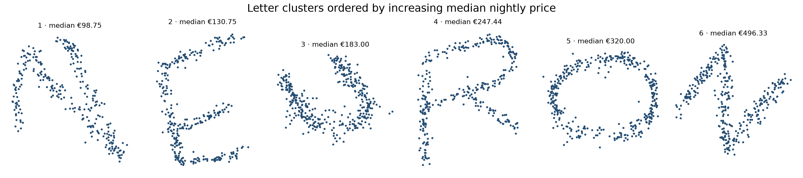

# Point par point

## Task

Find the word hidden among Paris accommodation listings. The solution needs code, a figure showing the letters and a `labels.csv` linking the selected points back to the listings.

## Approach

We use five features: latitude, longitude, nightly price, reviews per month and annual availability. Price and reviews per month are transformed with the natural logarithm, then all five features are standardised.

DBSCAN groups nearby points with `eps=0.25` and `min_samples=10`. We keep clusters containing at least 200 listings, which leaves six letter groups. We order them by increasing median nightly price and project each group into two dimensions with PCA. The display rotations are chosen manually so the letters can be read as **N E U R O N**.

The recovered flag is **`SIGMOID_NEURON`**.

## Why it works

The inserted points form dense shapes in the five selected features. The logarithms reduce the influence of large price and review values, while standardisation makes the different units comparable. DBSCAN can follow letter strokes without forcing every ordinary listing into a group. Separate PCA projections reveal the shapes, and price supplies their reading order.

## Run it

From this task folder, install the dependencies and rebuild the results:

```bash
python -m pip install -r requirements.txt
python solve.py
```

The script reads `data/paris_listings.csv` and writes the figure, listing labels and cluster summary under `results/`.

## Evidence and limits

| Letter position | Listings | Median price |
| --- | ---: | ---: |
| 1 | 292 | €98.75 |
| 2 | 312 | €130.75 |
| 3 | 384 | €183.00 |
| 4 | 324 | €247.44 |
| 5 | 383 | €320.00 |
| 6 | 343 | €496.33 |



`results/labels.csv` preserves every input row and adds its cluster and letter position. Position 0 means a listing was not selected for the word. `results/cluster_summary.csv` records each selected group's size and median price. `flag.txt` stores the word read from the figure.

The feature selection, cluster settings and display rotations were chosen during exploration. The script reproduces the clustering and figure; it does not automatically recognise letters. The third group is read as U after rotating it upright. These settings describe this puzzle rather than a general method for finding hidden words in other datasets.
