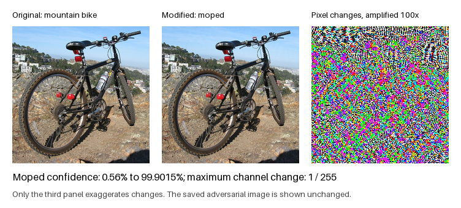

# Ciclopaseo Mirage

## Task

Make the supplied MobileNetV3 Large classifier predict **moped, class 665**, with at least **99% confidence** on a bicycle image. Each RGB channel may change by at most 1 on the 0 to 255 scale. The output must remain an RGB PNG with the same dimensions and fit within 1 MiB. The runtime limits are 60 seconds and 2 GiB of memory.

## Approach

We use the model's gradients to choose tiny pixel changes that raise the moped score. A momentum update keeps useful gradient directions, while smaller steps later in the run help refine the image. Every change is clipped to the allowed range.

The important detail is rounding. During optimisation, the model sees integer pixel values, exactly as it will after saving the PNG. A straight-through estimator passes gradients through the rounding operation. This lets us optimise the saved image instead of a floating-point version that might lose its effect when rounded.

We keep the best integer image and stop at 99.9% moped confidence, leaving a margin above the required 99%. Optimisation has a 40-second deadline measured from the start of the script's main routine. The saved PNG is then reloaded and checked again.

## Why it works

The classifier depends on many small pixel signals. Their combined effect can change its prediction even when each individual channel changes by only one level. Targeted gradients find useful changes much more efficiently than random noise. Rounding during the forward pass and checking the saved file prevent a result that works only before PNG serialization.

## Run it

Use Python 3.11. Install the CPU dependencies once:

```bash
python -m venv .venv
source .venv/bin/activate
python -m pip install -r requirements.txt
```

From this task folder, reproduce the training result and independent checks:

```bash
python verify.py
python check_variants.py
python plot.py
```

The default submission run is:

```bash
python main.py
```

It reads `test-input.png` and writes `test-output.png` in the working directory. Keep the supplied `challenge_model.py` and `classifier/mobilenet_v3_large-5c1a4163.pth` beside the script. The run is offline and uses two PyTorch CPU threads. Local experiments can use `--input` and `--output` arguments.

## Evidence and limits

The supplied solution was reported as passing by our team. The evidence here is our independent local reproduction, not a stored platform score. We use a separate checker that loads the checkpoint and performs preprocessing directly, without calling the solution's prediction helper.

| Check | Requirement | Independent training result |
| --- | --- | --- |
| Predicted class | 665, moped | 665 |
| Moped confidence | At least 0.99 | 0.9990146 |
| Maximum RGB channel change | At most 1 | 1 |
| Format and dimensions | RGB PNG, unchanged | RGB PNG, 224 × 224 |
| File size | At most 1,048,576 bytes | 114,648 bytes |
| Full subprocess runtime | At most 60 seconds | 4.08 seconds |
| Peak child-process memory | At most 2 GiB | About 408 MiB |

The original image predicts mountain bike, class 671. The attack reached its stopping threshold after 134 iterations on this machine. Timings and iteration counts can vary with hardware and library versions.



`results/train-adversarial.png` is the actual generated image. `results/training-check.json` records the independent checks, versions, runtime, memory and file hashes. The four transformed-image checks also pass; their measurements are in `results/variants.csv` and the reports under `results/variants/`. The training files under `data/` and the checkpoint are supplied challenge materials. The supplied `train-output.png` is kept separately from our generated output.

The resized, flipped and darkened images are variations of one photograph, not independent hidden examples. Earlier development reported difficulty on some 128 to 192 pixel images and oversized noisy PNGs at 1024 × 768; these particular cases were not rerun for this evidence. The committed checks cover the original, two resized versions, a flip and a darkened version. We cannot conclude that every small-image failure is an unavoidable limit of the pixel budget. The script prints its final checks, but a failed check does not change its exit status, so use the independent verifier to decide whether a local run passed.

The repository copy removes comments and docstrings from the supplied solution without changing its executable syntax. No flag value was supplied for this write-up.
